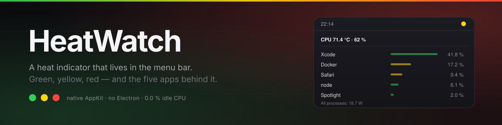

<p align="center">
  
</p>

<p align="center">
  
  
  
  
  
</p>

HeatWatch puts a colored dot next to your clock. Green while the Mac is calm,
yellow when it starts working, red when it is cooking — and a click shows the five
apps responsible for most of the heat right now.

It is a 736 KB native AppKit app. No Electron, no daemon, no network, no root
helper, no analytics. While the menu is closed it runs at **0.0 % CPU** with a
~22 MB footprint.

> **The released build is ad-hoc signed, not notarized** (no Apple Developer
> account behind this project). macOS will block the first launch until you clear
> the quarantine flag — one command, see [Install](#install).

## Features

- Menu bar dot driven by CPU die temperature and CPU load, with a bump when the
  temperature climbs fast
- Top five apps by energy draw, grouped by application (helpers roll into their app)
- Per-machine thresholds: bands follow the machine's own idle floor, so an Air and
  a MacBook Pro both get a meaningful scale
- Optional launch at login
- English and Portuguese (pt-BR) UI, following the system language
- Nothing leaves the machine

## Install

### Download

Grab the latest `HeatWatch-<version>.dmg` (or `.zip`) from
[Releases](../../releases), drag the app to `/Applications`, then clear the
quarantine flag once:

```sh
xattr -dr com.apple.quarantine /Applications/HeatWatch.app
```

Open the app normally. On macOS 14 and older the right-click → **Open** path also
works; on macOS 15+ use **System Settings → Privacy & Security → Open Anyway** if
you prefer the GUI.

Each release ships `SHA256SUMS`; verify with `shasum -a 256 -c SHA256SUMS` before
installing if you care about that.

### Build from source

Requires the Xcode command line tools (Swift 5.7+). No other dependency.

```sh
git clone https://github.com/RenatoTadeuFigueiredo/heatwatch.git
cd heatwatch
./install.sh          # builds universal, installs to /Applications, launches
```

`./build.sh` alone leaves the bundle in `build/`, and `./dist.sh` produces the
ZIP/DMG pair with checksums.

## Usage

Click the dot:

| Row | Meaning |
|---|---|
| `CPU 61.4 °C · 12 %` | Current die temperature and total CPU load |
| App rows | Energy draw per app over the last ~2 s, longest names clipped in the middle |
| `All processes: 7.1 W` | Total energy attributable to user processes |
| `Open at login` | Registers the app as a login item |

Quit from the menu. Uninstall by deleting `/Applications/HeatWatch.app`.

## How it works

| Signal | Source | Cost |
|---|---|---|
| Temperature | Private IOHID sensor API, `PMU tdie*` die sensors, five sampled per tick | ~3 ms / 10 s |
| Per-app energy | `proc_pid_rusage(RUSAGE_INFO_V6).ri_energy_nj`, diffed between snapshots and grouped by bundle | ~6 ms / 15 s closed, 2 s while open |

The dot color is `max(temperature band, load band)`, plus one level when the die
temperature rises 2 °C within a minute. Load is part of it because a well cooled
Mac hides heavy work behind a flat temperature curve.

Thresholds track the machine's idle floor — dropping instantly, drifting up 2 % per
tick — with fixed offsets of +8 °C and +18 °C. Absolute overrides win:

```sh
defaults write io.github.renatotadeufigueiredo.heatwatch warmCelsius 70
defaults write io.github.renatotadeufigueiredo.heatwatch hotCelsius 80
defaults write io.github.renatotadeufigueiredo.heatwatch warmLoadPercent 60
defaults write io.github.renatotadeufigueiredo.heatwatch hotLoadPercent 90
```

## Footprint

Measured on an M3 Max, macOS 27:

| State | CPU | Physical footprint |
|---|---|---|
| Idle, menu closed | 0.0 % | ~22 MB |
| Menu open (2 s refresh) | ~0.6 % | ~23 MB |

One temperature read every 10 s and one process scan every 15 s is the entire
background cost. Icons and menu rows are reused instead of rebuilt.

## Compatibility

- macOS 13 or newer, Apple Silicon and Intel.
- Apple Silicon exposes `PMU tdie` sensors. On Macs without them (Intel) the app
  falls back to CPU load and the header shows a percentage instead of °C.
- The temperature API is private. A macOS update can break it; the load fallback
  keeps the indicator alive meanwhile.

## Limitations

- Processes owned by root are unreadable without a privileged helper, so
  `WindowServer` and kernel threads never appear in the ranking. User apps do.
- Die temperature is not "how hot it feels"; the dots are a trend signal, not a
  thermal specification.
- No auto-update. Re-download to upgrade.
- Not notarized, and the private API rules out the App Store without a privileged
  helper running `powermetrics`.

## Privacy

No network access, no telemetry, no crash reporting, no TCC prompts. The only
state is user defaults for thresholds. Energy and temperature readings never leave
the machine.

## Contributing

Bug reports and pull requests are welcome — see [CONTRIBUTING.md](CONTRIBUTING.md).
The code is five small Swift/C files under `Sources/`; `--probe` prints one
temperature reading and one ranking without a UI, which is also what CI smokes.

## License

[MIT](LICENSE).
